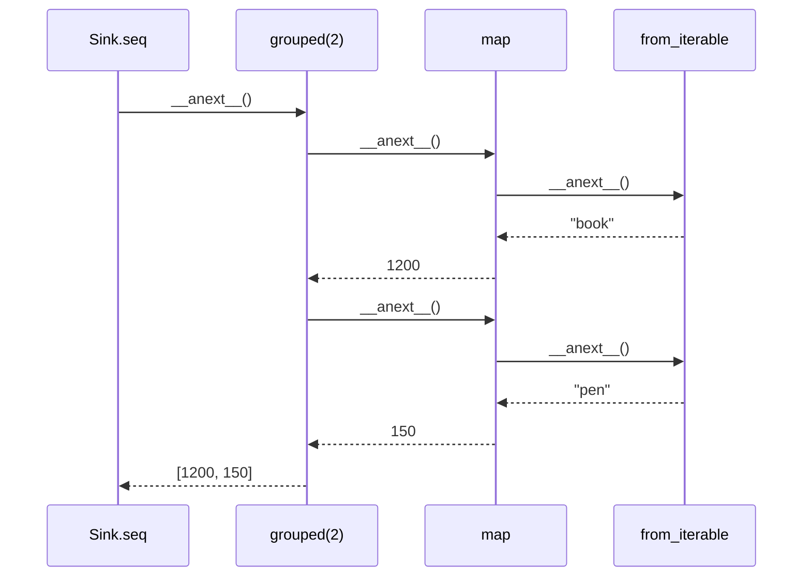
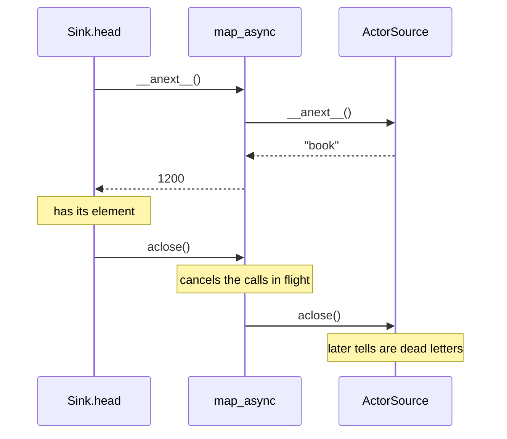

# 13. Streams

## The problem

Some work arrives as a sequence: lines of a file, rows from a query, frames from a socket, items a till scans. Each element goes through the same steps, some of them awaits on other services, and the program must not read faster than the slowest step can keep up with. When the consumer stops early, everything above it has to stop too, and close what it opened.

An `async for` over an async generator does all of that for a single chain. It gets harder once a step should run four lookups at once, wait for a timer, take elements from two places, or hand them to an actor that only takes tells. Written by hand, each of these needs its own tasks and queues, and each is a place where a cancel can get lost.

## The idea

A stream is described before it runs. A **source** produces elements, a **flow** transforms them, and a **sink** consumes them. Connected, they form a **blueprint**: a value that runs nothing yet. `run(system)` starts it and returns its **materialized value**, whatever the stream hands back to the code that started it, such as a future of the result, a queue to feed it, or an actor ref to tell. A blueprint can run any number of times, and each run starts from the beginning.

Elements move only when someone below asks for one. The sink pulls from the stage above it, which pulls from the one above, up to the source. This is **backpressure**: a slow sink slows the whole stream down, and nothing piles up between the stages. A sink that is done cancels the stages above it in the same way.

`ohra.stream` is Apache Pekko Streams' typed `Source`, `Flow` and `Sink`, built on Python's async iterators: a pull is `__anext__()`, and a cancel is `aclose()`.

## A first example

Price a list of SKUs, look each price up from a slow service, four at a time, and put them two to an invoice. It is [`examples/streams/pipeline.py`](../../examples/streams/pipeline.py):

```python
import asyncio
from collections.abc import Iterable

from ohra import ActorSystem, Behaviors
from ohra.stream import NotUsed, Sink, Source

PRICES = {"book": 1200, "pen": 150, "mug": 800}


async def look_up_price(sku: str) -> int:
    await asyncio.sleep(0.01)  # a call to the pricing service
    return PRICES[sku]


def invoices(skus: Iterable[str]) -> Source[list[int], NotUsed]:
    """The prices of the known SKUs, two to an invoice."""
    return (
        Source.from_iterable(skus)
        .filter(lambda sku: sku in PRICES)
        .map_async(4, look_up_price)  # up to 4 lookups at once, results in order
        .grouped(2)
    )


async def main() -> None:
    async with ActorSystem(Behaviors.empty, "pipeline") as system:
        blueprint = invoices(["book", "pen", "lamp", "mug"])
        print(await blueprint.run_with(Sink.seq(), system))  # [[1200, 150], [800]]
        total = blueprint.map(sum).run_fold(0, lambda acc, n: acc + n, system)
        print(await total)  # 2150


if __name__ == "__main__":
    asyncio.run(main())
```

`python pipeline.py` prints `[[1200, 150], [800]]` and then `2150`.

- **`invoices(...)` builds a blueprint and runs nothing.** Each operator returns a new `Source`, and its type says what comes out: `Source[list[int], NotUsed]`, lists of prices, with no materialized value worth keeping.
- **`map_async(4, look_up_price)`** keeps up to four lookups in flight and emits the prices in input order. `map_async_unordered` emits them as they finish.
- **`run_with(Sink.seq(), system)`** connects the sink, starts the stream and returns the sink's materialized value at once: a future of the list.
- **The same blueprint runs twice.** The second run iterates the list again from the start.
- **`system`** is where the stream runs: each run is an actor under `/system`. Pekko takes an implicit materializer here; ohra takes the system.

> **Coming from Apache Pekko**
>
> - The names are scaladsl's in snake_case: `Source.fromIterable` is `from_iterable`, `mapAsync` is `map_async`, `toMat` is `to_mat`, `runWith` is `run_with`. Durations are seconds as floats, and the system is passed to `run` explicitly.
> - `Source`, `Flow` and `Sink` declare Pekko's variance: `Source[+Out, +Mat]`, `Flow[-In, +Out, +Mat]`, `Sink[-In, +Mat]`. `NotUsed` and `Done` are classes, and their values are `NOT_USED` and `DONE`.
> - The graph runs fused in one asyncio task. There is no `.async`, no attributes, no `GraphDSL`, no junctions such as `Broadcast` or `Partition`, and no supervision strategy for stages; `recover` and `recover_with_retries` are ported.
> - Stream-typed's `ActorSource.actorRef`, `ActorSink.actorRef`, `ActorSink.actorRefWithBackpressure` and `ActorFlow.ask` are ported. `ActorSource.actorRefWithBackpressure`, the `withContext` and `askWithStatus` variants, `PubSub` and the stream test kit are not. [Appendix B](appendix-deviations.md) has the full list.

## How it works

### Blueprints and materialized values

A `Source`, `Flow`, `Sink` or `RunnableGraph` holds a build function and nothing else. `run(system)` calls it, so every run gets fresh stages, a fresh future from `Sink.seq`, and a fresh pass over the collection given to `from_iterable` (a one-shot iterator, such as a generator, is used up by the first run). `Flow.of(int)` starts a flow from nothing, as Pekko's `Flow[Int]` does:

```python
from ohra.stream import Flow, Sink, Source
from ohra.testkit import ActorTestKit


async def test_a_flow_is_a_reusable_piece(testkit: ActorTestKit):
    double = Flow.of(int).map(lambda n: n * 2)
    out = Source.from_iterable([1, 2, 3]).via(double).run_with(Sink.seq(), testkit.system)
    assert await out == [2, 4, 6]
```

Every stage has a materialized value, and `via` and `to` keep the left one, the one from upstream. `via_mat` and `to_mat` take a function that combines both: `Keep.left`, `Keep.right`, `Keep.both` or `Keep.none`, as Pekko's `Keep`. `run_with(sink)` is `to_mat(sink, Keep.right).run(system)`:

```python
from ohra.stream import DONE, Keep, Sink, Source
from ohra.testkit import ActorTestKit


async def test_keep_both_hands_back_both_values(testkit: ActorTestKit):
    graph = (
        Source.from_iterable([1, 2, 3])
        .watch_termination(Keep.right)  # the source's NotUsed is dropped
        .to_mat(Sink.fold(0, lambda total, n: total + n), Keep.both)
    )
    finished, total = graph.run(testkit.system)
    assert await total == 6
    assert await finished == DONE
```

`graph` is a `RunnableGraph[tuple[Future[Done], Future[int]]]`, and pyright knows it. `watch_termination` adds a future that completes with `DONE` when the stream ends, or fails with its exception; `map_materialized_value(f)` changes a materialized value.

`run` returns at once, and the stream starts on the next loop steps. The `Materializer` spawns one actor per run under `/system/Materializers/StreamSupervisor`, which drives the sink and stops when the stream ends. The stages run fused, in the one task that actor starts, and a stage that races its upstream against something else (`map_async` and `ActorFlow.ask`, `merge`, `zip`, `grouped_within`, the kill switch, `Sink.queue`, `ActorSink`) puts each pull in a task of its own. A source that never suspends, such as `Source.repeat`, lets the event loop run every 1000 elements, so even an endless stream can be stopped.

The stages share the event loop with every actor, so a function passed to a stage must not block. A `time.sleep` or a synchronous HTTP call in `map` holds up the whole process. Give `map_async` an `async def`, and move blocking work into a thread with `asyncio.to_thread`. [When a handler may await](01-actors.md#when-a-handler-may-await) shows how to find such calls.

A flow's input type is checked where it is attached. One that uses its input as the wrong type is a pyright error: `Source.from_iterable([1]).via(Flow.of(str).map(str.upper))` is rejected. A bare `Flow.of(str)` after a source of ints is accepted, since pyright widens its type to `int | str`, and an identity flow of `int | str` does take ints.

### Pull: demand goes up, elements come down

A sink pulls by calling `__anext__()` on the stage above it. Each stage is an async generator that pulls from its own upstream when it needs an element, so the call goes up to the source, and the element comes back down as the return value. Nothing moves until the sink asks:



A stage pulls as much as it needs to produce one element, and no more: `grouped(2)` pulls twice for each group, `filter` pulls until an element passes, `map_async(4, f)` pulls while fewer than four calls are in flight. The source's end comes down as `StopAsyncIteration`, and a failure comes down as its exception, raised from `__anext__()` in every stage below it. The sink's future fails with that exception, unless a `recover` stage on the way turns it into a last element.

### Cancel: the end goes up

A stage that needs no more elements closes its upstream with `aclose()`. `take(n)` starts to do so with its `n`th element, which it passes on without waiting for the close; `Sink.head()` after the first; a kill switch when it is thrown. Each stage holds its upstream in `contextlib.aclosing`, so the close goes up stage by stage, and each one runs its `finally` blocks, cancels its tasks and cancels its timers on the way:



A stage closed before it was ever pulled still closes its upstream, so a source's resources (a queue, a ref, a timer) are released however the stream ends.

### Operators

The operators are methods on both `Source` and `Flow`, with Pekko's names in snake_case:

- **One element at a time:** `map`, `filter`, `filter_not`, `collect`, `map_concat`, `scan`, `fold`. `collect(f)` stands in for Pekko's partial function: `f` returns `None` to skip an element, so it cannot emit `None` itself.
- **Async:** `map_async(parallelism, f)` and `map_async_unordered`. The first failure fails the stream, and the calls still running are cancelled.
- **Cutting:** `take`, `take_while`, `drop`, `drop_while`, `grouped`.
- **Failure:** `recover(f)` turns a failure into one last element, or rethrows when `f` returns `None`; `recover_with_retries(attempts, f)` switches to the source `f` returns.
- **Sources:** `Source.single`, `from_iterable`, `from_async_iterable` (a factory, called once per run), `future`, `repeat`, `empty`, `failed`, `queue` and `tick`.
- **Sinks:** `Sink.seq`, `foreach`, `fold`, `reduce`, `head`, `head_option`, `last`, `last_option`, `ignore`, `cancelled` and `queue`. Each materializes a future, apart from `queue` and `cancelled`. `head` and `last` of an empty stream fail with `LookupError`, Pekko's `NoSuchElementException`. `run_foreach`, `run_fold` and `run_reduce` are shorthands for `run_with`.

### Queues

`Source.queue` and `Sink.queue` connect a stream to code outside it. The first materializes a `SourceQueue` to `offer` elements into; the second a `SinkQueue` to `pull` them out of, one at a time:

```python
from ohra.stream import Keep, OverflowStrategy, QueueOfferResult, Sink, Source, SourceQueue
from ohra.testkit import ActorTestKit


async def test_a_stream_between_two_queues(testkit: ActorTestKit):
    orders: Source[str, SourceQueue[str]] = Source.queue(8, OverflowStrategy.backpressure)
    inbox, outbox = orders.map(str.upper).to_mat(Sink.queue(), Keep.both).run(testkit.system)
    assert await inbox.offer("book") == QueueOfferResult.Enqueued
    assert await outbox.pull() == "BOOK"
    inbox.complete()
    assert await outbox.pull() is None  # the stream has completed
```

- **`offer`** answers once the element is in the buffer: `Enqueued` (with a buffer, a drop strategy makes room by dropping another element), `Dropped` (with `buffer_size=0` under a drop strategy, or while the queue is completing), `QueueClosed` (the stream is over) or `QueueOfferResult.Failure(cause)`. Under `OverflowStrategy.backpressure` it waits while the buffer is full. Only one offer may wait at a time; a second raises `RuntimeError`, as in Pekko.
- **`complete()`** ends the stream once the buffer is drained, `fail(exc)` fails it, and `watch_completion()` is a future of the end.
- **`pull()`** returns the next element, `None` at the end, or raises the stream's failure. A stream that carries `None` elements is read with `async for` or `await anext(outbox, default)`, which tell a `None` element from the end. `Sink.queue` pulls upstream only when `pull` is called, and a `SinkQueue` is also an async iterator, so `async for x in outbox` reads it to the end. `cancel()` cancels the stream.
- **Annotate the source,** as `orders: Source[str, SourceQueue[str]] = ...`, since nothing in `Source.queue(...)` names the element type.

### Time

`Source.tick`, `throttle` and `grouped_within` wait on the system's scheduler, so they run on the clock of `ManualTime` from [chapter 12](12-testing.md#a-third-example-a-timer-with-manual-time):

- **`Source.tick(initial_delay, interval, tick)`** emits `tick` on a fixed delay, and drops a tick that finds no pull waiting. Its materialized value is a `Cancellable`; cancelling it completes the stream.
- **`throttle(elements, per, maximum_burst)`** lets at most `elements` through every `per` seconds, with bursts of up to `maximum_burst`. An element that comes too soon waits, which is Pekko's shaping mode.
- **`grouped_within(n, d)`** emits a group when it has `n` elements, or every `d` seconds with whatever has arrived. It never emits an empty group.

```python
import pytest

from ohra.stream import Source
from ohra.testkit import ActorTestKit, ManualTime, TestProbe


@pytest.mark.manual_time
async def test_throttle_lets_one_element_through_per_second(
    testkit: ActorTestKit, manual_time: ManualTime
):
    probe: TestProbe[int] = testkit.create_test_probe()
    done = (
        Source.from_iterable([1, 2, 3])
        .throttle(1, 1.0, maximum_burst=1)
        .run_foreach(probe.ref.tell, testkit.system)
    )
    await probe.expect_message(1)
    await manual_time.expect_no_message_for(0.9, probe)
    await manual_time.time_passes(0.1)
    await probe.expect_message(2)
    await manual_time.time_passes(1.0)
    await probe.expect_message(3)
    await done
```

`run_foreach(probe.ref.tell, ...)` tells the probe every element, so the test waits on messages, never on real time.

`time_passes` waits for the stream's task to reach its next pull before it moves the clock, as it waits for the actors, so a test of `tick` or `grouped_within` can move the clock right after `run`:

```python
@pytest.mark.manual_time
async def test_tick_emits_once_a_second(testkit: ActorTestKit, manual_time: ManualTime):
    probe: TestProbe[str] = testkit.create_test_probe()
    done = Source.tick(1.0, 1.0, "tick").take(2).run_foreach(probe.ref.tell, testkit.system)
    await manual_time.expect_no_message_for(0.9, probe)
    await manual_time.time_passes(0.1)
    await probe.expect_message("tick")
    await manual_time.time_passes(1.0)
    await probe.expect_message("tick")
    await done
```

`take(2)` cancels the tick source with the second tick, so `done` completes.

### Fan-in and kill switches

`merge`, `zip`, `zip_with` and `concat` take a second source, which is built and run with the stream. `merge` emits the elements of both as they arrive; `zip` pairs one from each and completes when either completes; `concat` emits all of the first, then the second, which it starts only once the first has completed (Pekko's `concatLazy`). `merge` and `concat` of two element types produce their union, as Pekko's `merge[U >: Out]` does.

A kill switch ends a stream from outside. `KillSwitches.single()` is a flow whose materialized value is a `UniqueKillSwitch`: `shutdown()` completes downstream, `abort(exc)` fails it, and both cancel upstream:

```python
from ohra.stream import DONE, Keep, KillSwitches, Sink, Source
from ohra.testkit import ActorTestKit


async def test_zip_pairs_two_sources(testkit: ActorTestKit):
    letters = Source.from_iterable("ab").concat(Source.single("c"))
    pairs = Source.from_iterable([1, 2, 3]).zip(letters).run_with(Sink.seq(), testkit.system)
    assert await pairs == [(1, "a"), (2, "b"), (3, "c")]


async def test_a_kill_switch_ends_an_endless_stream(testkit: ActorTestKit):
    switch, done = (
        Source.repeat("beat")
        .via_mat(KillSwitches.single(), Keep.right)
        .to_mat(Sink.ignore(), Keep.both)
        .run(testkit.system)
    )
    switch.shutdown()
    assert await done == DONE
```

`KillSwitches.single()` takes its element type from where it is used, as an argument of `via_mat` here. On a line of its own, give it a declared type, such as `switch: Flow[int, int, UniqueKillSwitch] = KillSwitches.single()`; unannotated, pyright strict reports its type as partially unknown.

### The actor stages

Three stages connect streams and actors, from Pekko's stream-typed module:

- **`ActorSource.actor_ref(completion_matcher, failure_matcher, buffer_size, overflow_strategy)`** is a source whose materialized value is an `ActorRef` that actors tell. Up to `buffer_size` elements wait for demand, and the overflow strategy decides what a full buffer does (`drop_head`, `drop_tail`, `drop_buffer`, or `fail` with `BufferOverflowError`). A message `completion_matcher` matches completes the stream once the buffer is drained; an exception `failure_matcher` returns fails it at once. Once the stream has ended, tells are dead letters.
- **`ActorFlow.ask(ref, make_message, timeout, parallelism=2)`** asks `ref` for each element, as `map_async` over `ask`, and emits the replies in order. A reply later than `timeout` fails the stream with `AskTimeoutError`, and `ref` stopping fails it with `WatchedActorTerminatedError`.
- **`ActorSink.actor_ref(ref, on_complete_message, on_failure_message)`** tells `ref` every element, then the completion message, or `on_failure_message(exc)` when the stream fails. It does not wait for `ref`; `ActorSink.actor_ref_with_backpressure(...)` sends one element at a time, each after `ref` has acknowledged the one before. Both complete when `ref` stops.

[`examples/streams/actors.py`](../../examples/streams/actors.py) has a pricing actor that answers `GetPrice`, and a ledger actor that adds up `Charge` messages and reports the total on `Closed`. A till is the stream between the actors that scan and the ledger:

```python
from actors import Broken, Charge, Closed, CloseTill, GetPrice, LedgerCmd, Scan, TillMsg
from ohra import ActorRef
from ohra.stream import ActorFlow, ActorSink, ActorSource, OverflowStrategy, RunnableGraph, Source


def till(
    prices: ActorRef[GetPrice], book: ActorRef[LedgerCmd]
) -> RunnableGraph[ActorRef[TillMsg]]:
    """A stream from the actors that scan, through the pricing actor, into the ledger."""
    scans: Source[TillMsg, ActorRef[TillMsg]] = ActorSource.actor_ref(
        completion_matcher=lambda msg: isinstance(msg, CloseTill),
        failure_matcher=lambda _: None,
        buffer_size=64,
        overflow_strategy=OverflowStrategy.fail,
    )
    return (
        scans.collect(lambda msg: msg.sku if isinstance(msg, Scan) else None)
        .via(ActorFlow.ask(prices, GetPrice, timeout=1.0))
        .map(Charge)
        .to(ActorSink.actor_ref(book, Closed(), Broken))
    )
```

- **`till(prices, book).run(system)`** returns the `ActorRef[TillMsg]` to tell `Scan("book")` and, at the end, `CloseTill()`. Each run is a new till with a new ref. The example's shop actor runs one for every checkout, from its handler.
- **`ActorSource` takes the whole protocol,** `Scan | CloseTill`, so the completion message can be told to the same ref; `collect` keeps the SKUs. Annotate the source, as here, since the lambdas don't name the type.
- **`ActorFlow.ask(prices, GetPrice, timeout=1.0)`** builds `GetPrice(sku, reply_to)` for each SKU, as `ask` does. The dataclass is the `make_message` function.
- **`Broken` is the failure message.** If a price never comes, the stream fails with `AskTimeoutError` and the ledger gets `Broken(AskTimeoutError(...))`. [`test_streams.py`](../../examples/streams/test_streams.py) shows it with manual time.

The route-owned WebSockets of [chapter 9](09-fastapi.md#websockets-the-route-owns-the-connection) are an `ActorSource` into a `Sink.queue`: the connection's actor tells the source's ref, and the route pulls the frames to send.

### Streams and terminate()

Streams run in actors under `/system`, which stop last, after the coordinated shutdown's phases and after the user's actors. Until then a stream runs on. When its actor stops, the stream is aborted, never left hanging:

```python
import pytest

from ohra.stream import AbruptStageTerminationError, Sink, Source
from ohra.testkit import ActorTestKit


async def test_terminate_fails_a_stream_that_is_still_running():
    async with ActorTestKit() as testkit:
        done = Source.repeat("tick").run_with(Sink.ignore(), testkit.system)
    with pytest.raises(AbruptStageTerminationError):
        await done
```

- **Every materialized future that hasn't completed fails** with `AbruptStageTerminationError`, Pekko's `AbruptStageTerminationException`. That covers `Sink.seq` and the other future sinks, `watch_termination`, `SourceQueue.watch_completion()` and a waiting `SinkQueue.pull()`.
- **The stages are cancelled.** Calls in flight in `map_async` are cancelled, timers are cancelled, an `ActorSource` stops taking tells, and an `ActorSink` tells its target `on_failure_message(AbruptStageTerminationError(...))`.
- **`terminate()` waits for the stream to tear down.** The stream is cancelled once, where it is waiting, as any cancelled task is, and its cleanup then runs: a source's `finally`, such as closing a connection, finishes before `when_terminated()` resolves. A cleanup still running after 1 s (`ohra.stream.materializer.TEARDOWN_TIMEOUT`) is logged and cancelled again, so a close that honors cancellation cannot hold `terminate()` up.
- **`run()` on a terminated system raises `RuntimeError`.** Streams started during the shutdown phases still run until `/system` stops.
- **To end a stream cleanly, end it before `/system` stops:** complete its source, throw its kill switch, or add a task to a coordinated shutdown phase that does so and waits for it. `ohra.ext.fastapi` drains its WebSockets that way, in the `service-stop` phase.

---

[← Testing](12-testing.md) · [Contents](README.md) · [Appendix A: Apache Pekko names →](appendix-pekko-names.md)
